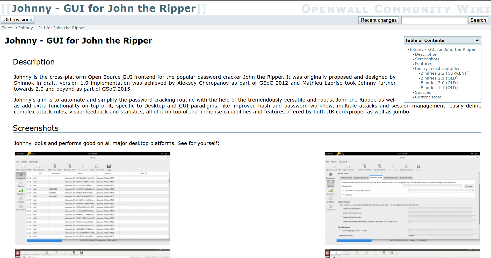
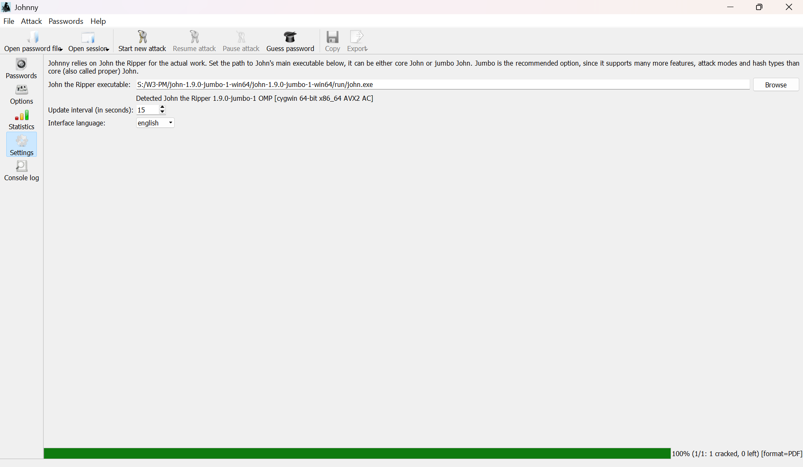
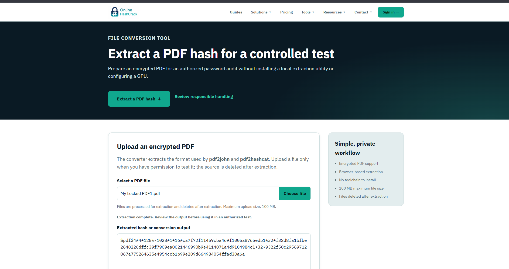
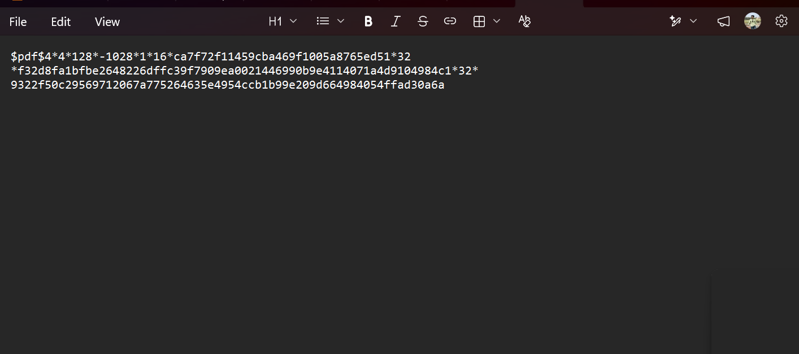
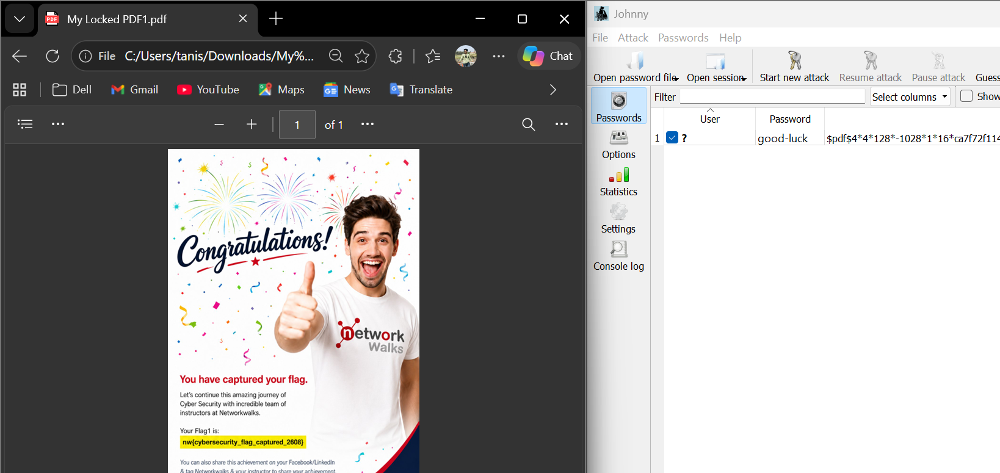

# Password Cracking Using John the Ripper (JTR)

A practical cybersecurity lab demonstrating password security auditing of an **authorized test PDF** using John the Ripper (JTR) and its graphical front end, Johnny.

> **Educational use only:** Run password audits only against files and hashes you own or have explicit permission to assess. Do not upload real password hashes, recovered credentials, or private documents to a public repository.

## Project Overview

John the Ripper is an open-source password security auditing and recovery tool. The Jumbo build supports many hash and file formats. Johnny provides a graphical interface for configuring the JTR executable, loading password-hash files, managing an audit, and viewing results.

This lab follows the supplied screenshots: review the JTR and Johnny project pages, configure Johnny to use the JTR Jumbo executable, extract a hash from a password-protected sample PDF, load the hash into Johnny, and verify the result by opening the test PDF.

## Objectives

- Understand the purpose of John the Ripper and Johnny.
- Configure Johnny to use the John the Ripper Jumbo executable.
- Extract a hash representation from an authorized, password-protected PDF.
- Load the hash file into Johnny and review the audit result.
- Verify the result against the sample PDF.
- Identify practical measures for improving password security.

## Tools and Environment

| Component | Purpose |
|---|---|
| Windows | Host operating system shown in the practical |
| John the Ripper Jumbo | Password-auditing engine |
| Johnny | GUI front end for John the Ripper |
| PDF hash extraction utility | Extracts a hash representation from the test PDF |
| Text editor | Stores the extracted hash for loading into Johnny |

## Repository Structure

```text
Password-Cracking-Using-John-The-Ripper/
├── README.md
├── commands.md
├── LICENSE
├── .gitignore
├── screenshots/
│   ├── 01-john-the-ripper-official-website.png
│   ├── 02-johnny-gui-overview.png
│   ├── ...
│   └── 11-verify-pdf-and-lab-flag.png
└── documentation/
    └── Password_Cracking_Using_John_the_Ripper_POC_Report.docx
```

## Practical Workflow

### 1. Review John the Ripper

Review the official Openwall project page to understand JTR, supported formats, and available builds.


### 2. Review Johnny GUI

Johnny is a graphical front end for John the Ripper. It provides a visual workflow for password files, attacks, sessions, and results.



### 3. Install and open Johnny

The supplied screenshots show the Johnny shortcut and installer package.


### 4. Configure the JTR executable

In Johnny's **Settings** section, browse to the John the Ripper Jumbo executable (`john.exe`). The screenshot shows Johnny detecting the `1.9.0-jumbo-1` build.




### 5. Extract the test PDF hash

Use a suitable PDF hash extraction utility with a test PDF that you own or are authorized to assess. Review the extracted output before using it.



### 6. Save the hash

Save the extracted hash in a plain-text file so that it can be loaded by Johnny. Keep this file private if it contains a real or sensitive hash.



### 7. Load the hash into Johnny

Use Johnny's password-file option to load the saved hash file. The supplied screenshot shows the entry recognized as PDF format.


### 8. Review and verify the result

The supplied lab screenshot shows Johnny displaying the recovered test password as `good-luck`. The password is then entered into the sample PDF, which opens successfully.




## Results

Based on the supplied lab screenshots:

- Johnny detected the configured John the Ripper Jumbo executable.
- A PDF-format hash record was loaded into Johnny.
- Johnny displayed the recovered sample password as `good-luck`.
- The password-protected sample PDF opened successfully after the password was entered.

The final screenshot also contains a training-lab completion flag. Consider keeping challenge flags out of public repositories if the training provider treats them as private assessment material.

## Security Recommendations

- Use long, unique, unpredictable passwords.
- Avoid common words, reused passwords, and predictable substitutions.
- Use modern password-based key derivation or hashing schemes appropriate to the application, such as Argon2id, scrypt, or bcrypt.
- Protect sensitive files with strong encryption.
- Do not publish real hashes, passwords, or confidential documents.
- Use multi-factor authentication where available.

## References

- [John the Ripper — Openwall](https://www.openwall.com/john/)
- [Johnny — Openwall Community Wiki](https://openwall.info/wiki/john/johnny)

## Author

**Tanish Soni**  
Cybersecurity | Ethical Hacking | Network Security

## Disclaimer

This repository documents an educational lab exercise. Password auditing and recovery must only be performed on files, systems, and hashes that you own or are explicitly authorized to assess.
