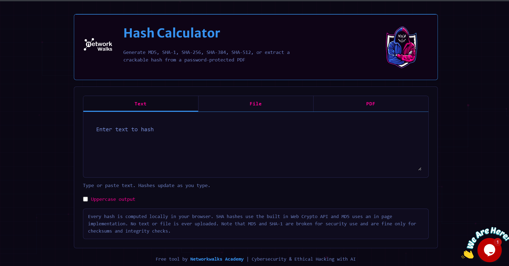
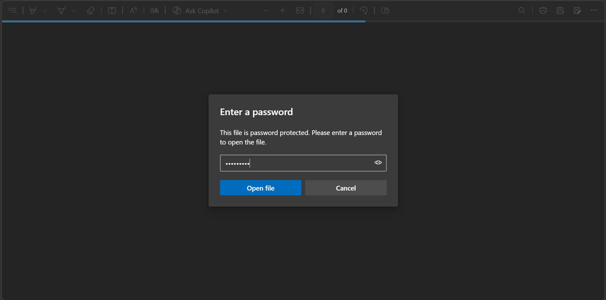

# Password Cracking with Networkwalks Tools

A practical cybersecurity lab demonstrating how to recover the password of a **provided, password-protected PDF** by extracting its hash and testing candidate passwords with a dictionary attack.

> **Learning purpose:** This repository documents an authorized training exercise using Networkwalks Academy tools and a sample PDF. Only perform password-recovery testing on files you own or have explicit permission to assess.

## Overview

The lab uses two Networkwalks tools:

1. **Hash Calculator** – extracts a PDF password hash in a format compatible with tools such as `pdf2john` / Hashcat.
2. **Password Cracker** – tests words from a built-in or uploaded wordlist against the extracted hash.

The demonstrated sample PDF was successfully unlocked during the exercise.

## Objectives

- Understand how password-protected PDF files store password-verification data.
- Extract a crackable PDF hash using the Hash Calculator.
- Run a dictionary attack against the hash using the Password Cracker.
- Verify the recovered password by opening the sample PDF.
- Record the lab completion evidence.

## Tools Used

| Tool | Purpose |
|---|---|
| Networkwalks Hash Calculator | Extracts a crackable hash from a password-protected PDF |
| Networkwalks Password Cracker | Performs a dictionary attack against the extracted hash |
| Web browser | Accesses the Networkwalks tools |
| Sample PDF | Authorized test file used in the lab |

## Lab Workflow

### Step 1 – Open the Hash Calculator

Open the Networkwalks Hash Calculator in a web browser. The tool supports generating MD5, SHA-1, SHA-256, SHA-384 and SHA-512 hashes, as well as extracting a crackable hash from a password-protected PDF.



### Step 2 – Upload the Password-Protected PDF

Select the **PDF** tab and upload the sample locked PDF. The tool parses the file locally and displays a PDF hash beginning with `$pdf$`.

Copy the complete hash value.


### Step 3 – Open the Password Cracker and Paste the Hash

Open the Networkwalks Password Cracker. Paste the complete `$pdf$...` hash into the PDF hash field.

The lab interface provides a built-in list of 100 passwords and also allows a `.txt` wordlist to be uploaded.


### Step 4 – Start the Dictionary Attack

Click **Start Cracking**. The tool checks candidate words from the selected wordlist against the PDF hash and displays the progress and attempted entries.

Wait for the process to finish.


### Step 5 – Verify the Recovered Password

The lab reports that the password was recovered. Enter the recovered password into the PDF viewer's password prompt to confirm that the sample PDF opens successfully.



### Step 6 – Confirm Lab Completion

The training page displays a completion message and a flag after the PDF is successfully opened.


## Result

The dictionary attack successfully recovered the password for the supplied training PDF, and the password was verified by opening the document. The lab completion page then displayed the first flag.

## Key Learnings

- A PDF password hash can be extracted into a format suitable for password-auditing tools.
- A dictionary attack tests candidate passwords from a wordlist rather than trying every possible character combination.
- The success of a dictionary attack depends heavily on whether the correct password is present in the selected wordlist.
- Hash extraction and password verification are separate stages: the recovered password should be tested against the original file.

## Security Notes

- Use these techniques only for authorized password recovery, security testing, and controlled training labs.
- Do not upload confidential or third-party documents to online services unless you are authorized and have reviewed the service's privacy and data-handling practices.
- The Hash Calculator interface shown in this lab states that processing is performed locally in the browser. Confirm the current tool's behavior and privacy notice before using it with sensitive files.
- MD5 and SHA-1 are considered unsuitable for modern security-sensitive password storage. Use a purpose-built password-hashing scheme such as Argon2id, scrypt, bcrypt, or PBKDF2 when designing systems that store passwords.

## Repository Structure

```text
password-cracking-networkwalks/
├── README.md
└── screenshots/
    ├── 01-hash-calculator-text-tab.png
    ├── 02-extract-pdf-hash.png
    ├── 03-paste-hash-into-dictionary-cracker.png
    ├── 04-dictionary-attack-success.png
    ├── 05-enter-cracked-pdf-password.png
    └── 06-lab-completion-flag.png
```

## Disclaimer

This repository is for educational and defensive cybersecurity learning. The screenshots and workflow document a controlled training exercise. The author does not encourage unauthorized access to password-protected files.
