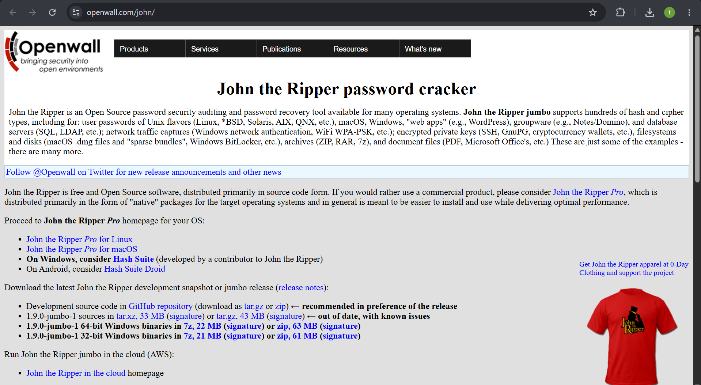
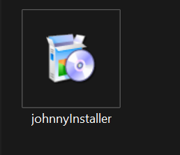
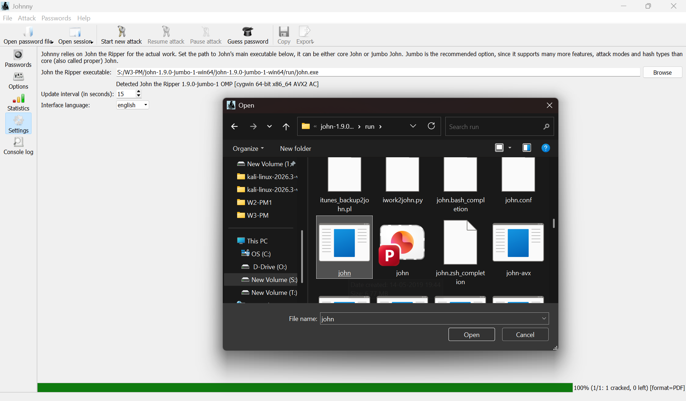
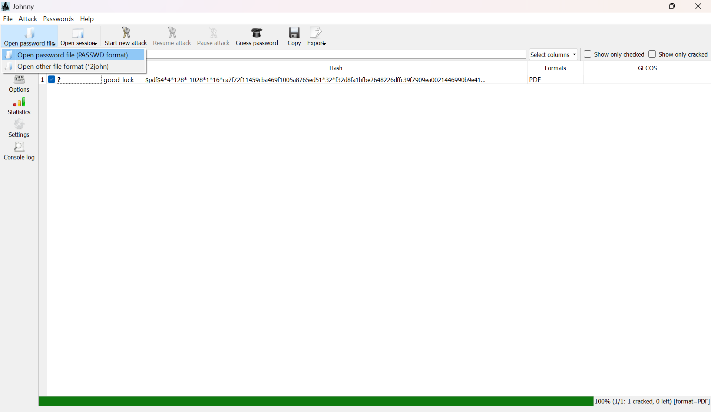
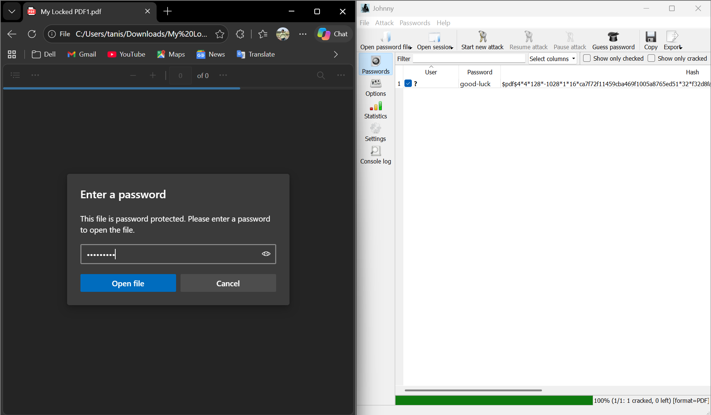
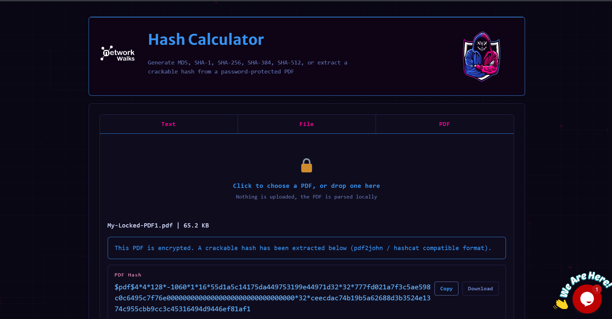
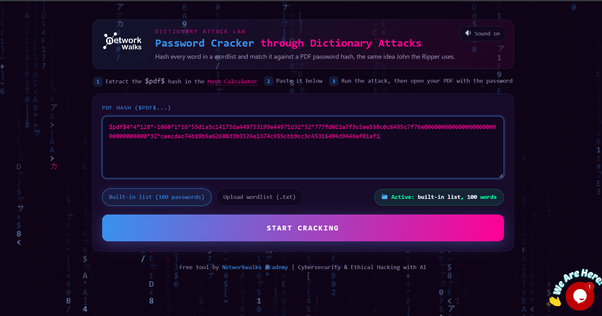

# Password Cracking Using John the Ripper (JTR)

A practical cybersecurity lab demonstrating password security auditing of an **authorized test PDF** using John the Ripper (JTR) and its graphical front end, Johnny.

> **Educational use only:** Run password audits only against files and hashes you own or have explicit permission to assess. Do not upload real password hashes, recovered credentials, or private documents to a public repository.

## Project Overview

John the Ripper is an open-source password security auditing and recovery tool. The Jumbo build supports many hash and file formats. Johnny provides a graphical interface for configuring the JTR executable, loading password-hash files, managing an audit, and viewing results.

This lab follows the supplied screenshots: review the JTR and Johnny project pages, configure Johnny to use the JTR Jumbo executable, extract a hash from a password-protected sample PDF, load the hash into Johnny, and verify the result by opening the test PDF.

## Objectives

- Understand the purpose of John the Ripper and Johnny.
- Configure Johnny to use the John the Ripper Jumbo executable.
- Extract a hash representation from an authorized, password-protected PDF.
- Load the hash file into Johnny and review the audit result.
- Verify the result against the sample PDF.
- Identify practical measures for improving password security.

## Tools and Environment

| Component | Purpose |
|---|---|
| Windows | Host operating system shown in the practical |
| John the Ripper Jumbo | Password-auditing engine |
| Johnny | GUI front end for John the Ripper |
| PDF hash extraction utility | Extracts a hash representation from the test PDF |
| Text editor | Stores the extracted hash for loading into Johnny |

## Repository Structure

```text
Password-Cracking-Using-John-The-Ripper/
├── README.md
├── commands.md
├── LICENSE
├── .gitignore
├── screenshots/
│   ├── 01-john-the-ripper-official-website.png
│   ├── 02-johnny-gui-overview.png
│   ├── ...
│   └── 11-verify-pdf-and-lab-flag.png
└── documentation/
    └── Password_Cracking_Using_John_the_Ripper_POC_Report.docx
```

## Practical Workflow

### 1. Review John the Ripper

Review the official Openwall project page to understand JTR, supported formats, and available builds.



### 2. Review Johnny GUI

Johnny is a graphical front end for John the Ripper. It provides a visual workflow for password files, attacks, sessions, and results.


### 3. Install and open Johnny

The supplied screenshots show the Johnny shortcut and installer package.




### 4. Configure the JTR executable

In Johnny's **Settings** section, browse to the John the Ripper Jumbo executable (`john.exe`). The screenshot shows Johnny detecting the `1.9.0-jumbo-1` build.




### 5. Extract the test PDF hash

Use a suitable PDF hash extraction utility with a test PDF that you own or are authorized to assess. Review the extracted output before using it.


### 6. Save the hash

Save the extracted hash in a plain-text file so that it can be loaded by Johnny. Keep this file private if it contains a real or sensitive hash.


### 7. Load the hash into Johnny

Use Johnny's password-file option to load the saved hash file. The supplied screenshot shows the entry recognized as PDF format.



### 8. Review and verify the result

The supplied lab screenshot shows Johnny displaying the recovered test password as `good-luck`. The password is then entered into the sample PDF, which opens successfully.




## Results

Based on the supplied lab screenshots:

- Johnny detected the configured John the Ripper Jumbo executable.
- A PDF-format hash record was loaded into Johnny.
- Johnny displayed the recovered sample password as `good-luck`.
- The password-protected sample PDF opened successfully after the password was entered.

The final screenshot also contains a training-lab completion flag. Consider keeping challenge flags out of public repositories if the training provider treats them as private assessment material.

## Security Recommendations

- Use long, unique, unpredictable passwords.
- Avoid common words, reused passwords, and predictable substitutions.
- Use modern password-based key derivation or hashing schemes appropriate to the application, such as Argon2id, scrypt, or bcrypt.
- Protect sensitive files with strong encryption.
- Do not publish real hashes, passwords, or confidential documents.
- Use multi-factor authentication where available.

## References

- [John the Ripper — Openwall](https://www.openwall.com/john/)
- [Johnny — Openwall Community Wiki](https://openwall.info/wiki/john/johnny)

## Author

**Tanish Soni**  
Cybersecurity | Ethical Hacking | Network Security

## Disclaimer

This repository documents an educational lab exercise. Password auditing and recovery must only be performed on files, systems, and hashes that you own or are explicitly authorized to assess.

==========================================================================================================================================================


# Password Cracking with Networkwalks Tools

A practical cybersecurity lab demonstrating how to recover the password of a **provided, password-protected PDF** by extracting its hash and testing candidate passwords with a dictionary attack.

> **Learning purpose:** This repository documents an authorized training exercise using Networkwalks Academy tools and a sample PDF. Only perform password-recovery testing on files you own or have explicit permission to assess.

## Overview

The lab uses two Networkwalks tools:

1. **Hash Calculator** – extracts a PDF password hash in a format compatible with tools such as `pdf2john` / Hashcat.
2. **Password Cracker** – tests words from a built-in or uploaded wordlist against the extracted hash.

The demonstrated sample PDF was successfully unlocked during the exercise.

## Objectives

- Understand how password-protected PDF files store password-verification data.
- Extract a crackable PDF hash using the Hash Calculator.
- Run a dictionary attack against the hash using the Password Cracker.
- Verify the recovered password by opening the sample PDF.
- Record the lab completion evidence.

## Tools Used

| Tool | Purpose |
|---|---|
| Networkwalks Hash Calculator | Extracts a crackable hash from a password-protected PDF |
| Networkwalks Password Cracker | Performs a dictionary attack against the extracted hash |
| Web browser | Accesses the Networkwalks tools |
| Sample PDF | Authorized test file used in the lab |

## Lab Workflow

### Step 1 – Open the Hash Calculator

Open the Networkwalks Hash Calculator in a web browser. The tool supports generating MD5, SHA-1, SHA-256, SHA-384 and SHA-512 hashes, as well as extracting a crackable hash from a password-protected PDF.


### Step 2 – Upload the Password-Protected PDF

Select the **PDF** tab and upload the sample locked PDF. The tool parses the file locally and displays a PDF hash beginning with `$pdf$`.

Copy the complete hash value.



### Step 3 – Open the Password Cracker and Paste the Hash

Open the Networkwalks Password Cracker. Paste the complete `$pdf$...` hash into the PDF hash field.

The lab interface provides a built-in list of 100 passwords and also allows a `.txt` wordlist to be uploaded.



### Step 4 – Start the Dictionary Attack

Click **Start Cracking**. The tool checks candidate words from the selected wordlist against the PDF hash and displays the progress and attempted entries.

Wait for the process to finish.


### Step 5 – Verify the Recovered Password

The lab reports that the password was recovered. Enter the recovered password into the PDF viewer's password prompt to confirm that the sample PDF opens successfully.


### Step 6 – Confirm Lab Completion

The training page displays a completion message and a flag after the PDF is successfully opened.


## Result

The dictionary attack successfully recovered the password for the supplied training PDF, and the password was verified by opening the document. The lab completion page then displayed the first flag.

## Key Learnings

- A PDF password hash can be extracted into a format suitable for password-auditing tools.
- A dictionary attack tests candidate passwords from a wordlist rather than trying every possible character combination.
- The success of a dictionary attack depends heavily on whether the correct password is present in the selected wordlist.
- Hash extraction and password verification are separate stages: the recovered password should be tested against the original file.

## Security Notes

- Use these techniques only for authorized password recovery, security testing, and controlled training labs.
- Do not upload confidential or third-party documents to online services unless you are authorized and have reviewed the service's privacy and data-handling practices.
- The Hash Calculator interface shown in this lab states that processing is performed locally in the browser. Confirm the current tool's behavior and privacy notice before using it with sensitive files.
- MD5 and SHA-1 are considered unsuitable for modern security-sensitive password storage. Use a purpose-built password-hashing scheme such as Argon2id, scrypt, bcrypt, or PBKDF2 when designing systems that store passwords.

## Repository Structure

```text
password-cracking-networkwalks/
├── README.md
└── screenshots/
    ├── 01-hash-calculator-text-tab.png
    ├── 02-extract-pdf-hash.png
    ├── 03-paste-hash-into-dictionary-cracker.png
    ├── 04-dictionary-attack-success.png
    ├── 05-enter-cracked-pdf-password.png
    └── 06-lab-completion-flag.png
```

## Disclaimer

This repository is for educational and defensive cybersecurity learning. The screenshots and workflow document a controlled training exercise. The author does not encourage unauthorized access to password-protected files.
